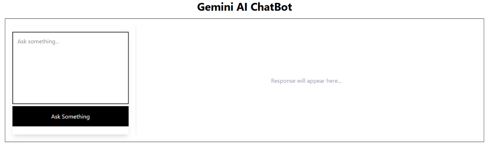
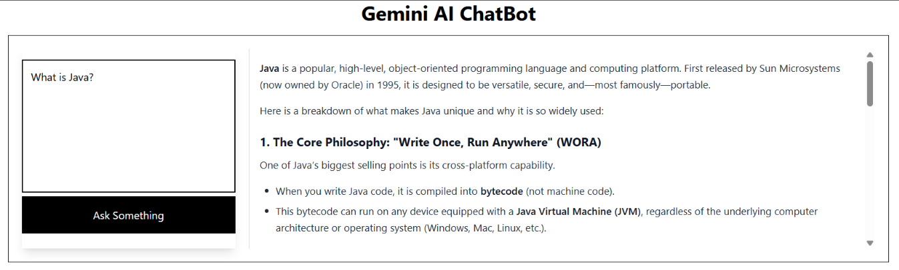

# 🤖 Gemini AI ChatBot

A full-stack, responsive AI ChatBot powered by Google's Gemini API. Built using React 19, Vite, Tailwind CSS, Node.js, and Express.js, this application allows users to interact with Google's Gemini AI and receive intelligent responses with beautifully formatted Markdown.

---

## 📸 Preview & Highlights

### Home Screen


### Active Response View


---

## ✨ Features

- **AI-Powered Responses:** Generates intelligent responses using Google's Gemini API (`gemini-3.5-flash-lite`).
- **Markdown Rendering:** Displays AI responses with formatted headings, paragraphs, lists, bold text, and code blocks using React Markdown.
- **Loading Indicator:** Animated loading spinner while waiting for AI responses.
- **Responsive UI:** Clean, responsive two-column interface with a query input panel and scrollable response panel.
- **Input Validation:** Handles user input and prevents empty submissions.
- **REST API Integration:** Connects the React frontend to the Express.js backend using Axios.
- **Error Handling:** Provides feedback when API requests fail.

---

## 🛠️ Tech Stack

### Frontend
- **React 19** – UI development
- **Vite 8** – Development server and build tool
- **Tailwind CSS v4** – Styling
- **Axios** – HTTP requests
- **React Markdown** – Markdown rendering

### Backend
- **Node.js** – JavaScript runtime
- **Express.js 5** – Backend framework
- **Google Generative AI SDK (`@google/generative-ai`)** – Gemini API integration
- **CORS** – Cross-origin resource sharing
- **dotenv** – Environment variable management
- **Nodemon** – Development server auto-reloading

---

## 📂 Project Structure

```text
Gemini-ChatBot/
│
├── backend/
│   ├── .env.example
│   ├── package.json
│   └── server.js
│
├── frontend/
│   ├── public/
│   ├── src/
│   │   ├── assets/
│   │   ├── App.css
│   │   ├── App.jsx
│   │   ├── index.css
│   │   ├── Loader.jsx
│   │   └── main.jsx
│   ├── eslint.config.js
│   ├── index.html
│   ├── package.json
│   └── vite.config.js
│
├── screenshots/
│   ├── home.png
│   └── response.png
│
├── .gitignore
└── README.md
```

---

## 🚀 Getting Started

Follow these steps to run the project locally.

### Prerequisites
- Node.js
- npm
- Google Gemini API Key

### 1. Clone the Repository

```bash
git clone YOUR_GITHUB_REPOSITORY_LINK
cd Gemini-ChatBot
```

### 2. Setup the Backend

Navigate to the backend directory:

```bash
cd backend
```

Install dependencies:

```bash
npm install
```

Create a `.env` file inside the `backend` directory:

```env
PORT=3000
KEY=your_gemini_api_key
```

Start the backend server:

```bash
npm start
```

The backend will run at:

```text
http://localhost:3000
```

### 3. Setup the Frontend

Open another terminal and navigate to the frontend directory:

```bash
cd frontend
```

Install dependencies:

```bash
npm install
```

Start the development server:

```bash
npm run dev
```

Open your browser and visit:

```text
http://localhost:5173
```

---

## 🔌 API Endpoint

### `POST /ask`

This endpoint receives a user's question and returns an AI-generated response.

| Property | Value |
| :--- | :--- |
| **Endpoint** | `/ask` |
| **Method** | `POST` |
| **Content-Type** | `application/json` |

---

## 📜 Available Scripts

### Backend

| Command | Description |
| :--- | :--- |
| `npm start` | Starts the backend server |
| `npm run dev` | Starts the development server with Nodemon, if configured |

### Frontend

| Command | Description |
| :--- | :--- |
| `npm run dev` | Starts the Vite development server |

---

## 🔐 Environment Variables

The backend requires the following environment variables:

| Variable | Description |
| :--- | :--- |
| `PORT` | Backend server port |
| `KEY` | Google Gemini API key |

> **Important:** Never commit your `.env` file or expose your Gemini API key publicly.

---

**Built with using React, Node.js, Express.js, and Google Gemini AI.**
